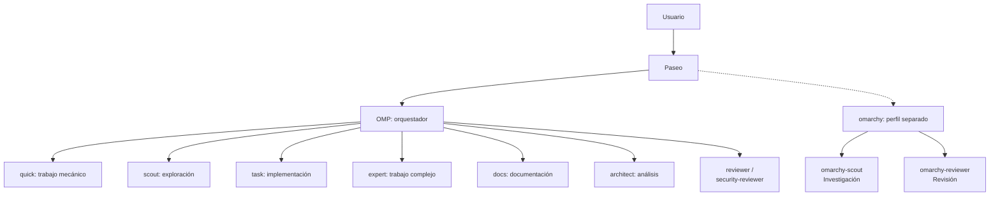

# Configuración Agéntica Personal

Este repositorio registra la configuración local de agentes de **Oh My Pi (OMP)** y su uso desde **Paseo**, con el propósito de documentar una experiencia de desarrollo asistido por agentes. Las instrucciones activas de los agentes se copian en [`agents/`](agents/).

## ¿Por qué Oh My Pi?

Porque permitía la conexión de los diferentes planes que estaban a mi disposición y buscaba un harness que pudiese optimizar al máximo el consumo de tokens debido a la limitación de tener un plan intermedio (GPT Plus). A su misma vez, utilizar modelos de otros proveedores conectados a una misma interfaz.
Oh My Pi tenía un harness preconfigurado del original Pi, una vez analizado y comparado con otras opciones, fue seleccionado por su alta personalización, delegación de tareas y despliegue de subagentes.

Paseo es solo una interfaz gráfica implementada para tener una experiencia más cómoda, ya que OMP solo ofrece una CLI. 

## Arquitectura y workflow

Paseo entrega la solicitud al perfil principal de OMP. El orquestador clasifica complejidad, riesgo e incertidumbre y utiliza una tabla explícita para seleccionar agentes. Resuelve directamente el trabajo trivial y delega solo cuando el beneficio supera el costo de coordinación; las ramas del diagrama son alternativas, no pasos que se ejecutan siempre.



Flujo típico:

1. **Clasificación y contrato.** Antes del trabajo sustancial, el orquestador fija objetivo, criterios de aceptación, alcance, restricciones, riesgos y comprobaciones observables. Las decisiones de arquitectura permanecen en el padre salvo escalamiento justificado.
2. **Selección y planificación.** `quick` reúne búsquedas, diagnósticos inocuos y cambios mecánicos con diseño decidido; `task` implementa trabajo acotado; `expert` ejecuta implementaciones complejas y migraciones. `scout` explora, `docs` redacta a partir de fuentes y `architect` analiza problemas difíciles sin escribir ni delegar a escritores: solo puede lanzar `scout`.
3. **Delegación delimitada.** Cada encargo define dependencias, ámbito de escritura permitido y prohibido, aceptación y salida esperada. Los trabajadores concurrentes no comparten propiedad de escritura. Se solicitan retornos de unos 1.500 tokens, sin omitir evidencia necesaria; el riesgo y la revisión prevalecen sobre los atajos de costo.
4. **Validación y escalamiento.** Se ejecutan las comprobaciones pertinentes cuando las dependencias están listas. Los fallos se diagnostican antes de repetir; se permite una corrección acotada al mismo nivel y luego se escala según la causa. No se debilitan pruebas de aceptación para hacer pasar una implementación.
5. **Integración y revisión.** El orquestador comprueba interfaces, compatibilidad, alcance e integración y solicita revisión independiente a `reviewer`. Los cambios sensibles —autenticación, secretos, ejecución de comandos, privilegios, dependencias o exposición de red, entre otros— requieren `security-reviewer`. El informe distingue resultados comprobados, riesgos pendientes y verificaciones no ejecutadas.

El hook [`hooks/pre/guard.ts`](hooks/pre/guard.ts) añade controles ejecutables sin sustituir los límites de cada agente. Para `quick`, bloquea comandos privilegiados, operaciones mutantes de `systemctl` y operaciones Git forzadas o destructivas cubiertas. Para todos los agentes, inspecciona destinos locales declarados por `write`, `edit`, `ast_edit` y acciones mutantes de `lsp` para impedir cambios en `/usr/share/omarchy` y sus descendientes; la lectura sigue permitida. Contempla rutas relativas, renombres y enlaces simbólicos, pero **no es una sandbox**: no contiene scripts, expansiones, alias, Bash de otros agentes ni cambios LSP sobre referencias no declaradas.

`omarchy` sigue siendo un perfil separado, no un agente lanzable por el orquestador. Conserva la autoridad sobre cambios de configuración y puede delegar a sus especialistas o a `quick`; en este último caso, únicamente para diagnósticos no mutantes y búsquedas.

## Personalización del agente Omarchy

Omarchy es una distribución Linux basada en Arch, con Hyprland. Su [sitio oficial](https://omarchy.org/) la presenta como un sistema “malleable” para la era de los agentes y anima a expresar en lenguaje natural las modificaciones deseadas. Esa visión motiva el uso de IA en este workflow: convertir necesidades del usuario en cambios de configuración concretos, entendibles y verificables, manteniendo a la persona al mando.

El perfil `omarchy` especializa el workflow en la configuración del sistema instalado. Diagnostica antes de cambiar, consulta la configuración y los valores por defecto, prefiere comandos oficiales y configuración del usuario, y puede delegar investigación de solo lectura y revisión a `omarchy-scout` y `omarchy-reviewer`. Su perfil declara además `quick` entre sus `spawns`. Esta especialización es crucial para personalizar y hacer avanzar la instalación de forma segura y mantenible; no modifica `/usr/share/omarchy/` ni reemplaza un flujo de desarrollo del código fuente de la distro.

## Agentes y perfiles configurados

| Agente | Uso y límites | Modelo actual configurado |
| --- | --- | --- |
| [`orchestrator`](agents/orchestrator.md) | Clasifica complejidad y riesgo, selecciona agentes con una tabla explícita, define contratos, integra y valida resultados y exige revisión independiente. | `openai-codex/gpt-6.1-sol:medium` (`@orchestrator`) |
| [`architect`](agents/architect.md) | Análisis de arquitectura, invariantes, concurrencia, depuración difícil y riesgos; solo lectura. Únicamente puede delegar investigación a `scout`. | `anthropic/claude-opus-5-5` (`@slow`) |
| [`docs`](agents/docs.md) | Documentación e instrucciones basadas en fuentes; no inventa decisiones ni comportamiento. Puede delegar investigación de solo lectura a `scout`. | `openai-codex/gpt-6.1-terra:medium` (`@docs`) |
| [`expert`](agents/expert.md) | Implementación compleja, refactorizaciones profundas, depuración difícil y migraciones delimitadas. Habilitado en los `spawns` del orquestador; no delega por cuenta propia. | `anthropic/claude-opus-5-5` (`@expert`) |
| [`quick`](agents/quick.md) | Búsquedas, diagnósticos inocuos y trabajo mecánico especificado: boilerplate, ediciones repetitivas, refactorizaciones, pruebas simples y documentación. No decide diseño ni delega; conserva restricciones explícitas y controles adicionales del hook. | `openai-codex/gpt-6-luna:low` (selector directo) |
| [`omarchy`](agents/omarchy.md) | Perfil separado para diagnóstico y configuración segura de Omarchy. Conserva autoridad sobre cambios del sistema y delega a `quick` solo diagnósticos no mutantes. | `anthropic/claude-opus-5-5` (`@omarchy`) |
| [`omarchy-scout`](agents/omarchy-scout.md) | Investigación Omarchy de solo lectura sobre configuración, defaults, comandos y documentación. | `openai-codex/gpt-6.1-terra:medium` (`@scout`) |
| [`omarchy-reviewer`](agents/omarchy-reviewer.md) | Revisión Omarchy de solo lectura para corrección, seguridad y regresiones. Comparte el rol de revisión sensible. | `anthropic/claude-opus-5-5` (`@review`) |
| `scout` | Explora repositorios y devuelve hallazgos con rutas y evidencia, en modo de solo lectura. | `openai-codex/gpt-6.1-terra:medium` (`@scout`) |
| `task` | Implementación acotada según el contrato y los límites definidos por el padre. | `openai-codex/gpt-6.1-terra:medium` (`@task`) |
| `reviewer` | Revisión independiente de corrección y calidad; tiene un rol propio para no modificar las revisiones sensibles. | `anthropic/claude-sonnet-5-5` (`@reviewer`) |
| `security-reviewer` | Revisión de vulnerabilidades, límites de confianza y cambios sensibles para la seguridad. | `anthropic/claude-opus-5-5` (`@review`) |

Los modelos corresponden a esta rama de configuración, no a los modelos del benchmark resumido abajo. Los identificadores y asignaciones pueden cambiar en OMP. Los modelos Claude no fijan un nivel de razonamiento en el selector; se aplica el nivel predeterminado de la configuración.

## Benchmark para elegir el modelo orquestador (03/09/2026)

Se realizaron 72 corridas: cuatro modelos, seis categorías (navegación/scout, bug simple, debugging no local, seguimiento de instrucciones, code review y orchestration) y tres repeticiones por modelo y categoría. El entorno usó OMP v18.1.4, `thinking=medium`, timeout de 600 s, un repositorio Python sintético reproducible de 5.077 líneas, fixtures y referencias Git congeladas, tests públicos/ocultos y scoring determinista cuando era posible. Se reportaron tanto resultados end-to-end como resultados condicionados a que el proveedor aceptara la petición, para separar calidad de errores `429`.

**Luna** y **Terra** casi empataron en resultado general end-to-end (83,52 y 83,42; 77,8% de éxito E2E y 17/18 corridas aceptadas cada uno). En corridas aceptadas promediaron 88,43 y 88,33 puntos, respectivamente. Luna fue más eficiente como worker (misma calidad de 96,25; mediana de 39.239 tokens y 5,5 llamadas a herramientas, frente a 54.828 y 7,5 de Terra) y en review, con calidad equivalente: ambos obtuvieron 94 puntos, encontraron los cinco defectos y tuvieron cero falsos positivos/negativos. Luna completó review en 69,42 s y 8 herramientas, frente a 111,37 s y 20 de Terra. También logró 100/100 en seguimiento de instrucciones y debugging no local en corridas aceptadas. **Terra** fue mejor scout (98,26 vs. 97,88), con menor latencia, uso de herramientas y tokens; por ello se recomendó Terra para exploración. Más adelante fue reemplazado por **GPT-6 Luna** debido a que tenía mejor índice de inteligencia por mucho menor costo.


La conclusión más importante fue que **no existe una escalera simple “Luna < Terra < Sol” para todas las tareas**. El mejor diseño fue especializar modelos por función: Luna para ejecución cotidiana, Terra para exploración/coordinación y un modelo superior para problemas realmente complejos.

Ante estos resultados encontrados, se comenzó a identificar el patrón de que un modelo más barato puede ser muy potente cuando es dirigido por un modelo el cual tiene mejor razonamiento, lo cual llevó a actualizar muchas medidas a las actualizaciones de modelos como **GPT-6.1 Sol** y **GPT-6 Luna**, los cuales tuvieron una mejoría considerable en cuanto a costo-inteligencia.


## Estructura

```text
.
├── README.md
├── config.yml
├── agents/
│   ├── architect.md
│   ├── docs.md
│   ├── expert.md
│   ├── omarchy-reviewer.md
│   ├── omarchy-scout.md
│   ├── omarchy.md
│   ├── orchestrator.md
│   └── quick.md
└── hooks/
    └── pre/
        └── guard.ts
```


`config.yml` es una copia de la configuración OMP observada en este equipo; registra preferencias de modelos, proveedores y comportamiento, no credenciales. Revísala y adáptala antes de usarla en otro entorno.

