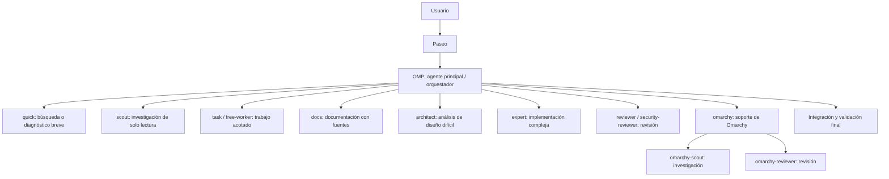

# Configuración Agéntica Personal

Este repositorio registra la configuración local de agentes de **Oh My Pi (OMP)** y su uso desde **Paseo**, con el propósito de documentar una experiencia de desarrollo asistido por agentes. Las instrucciones activas de los agentes se copian en [`agents/`](agents/).

## ¿Por qué Oh My Pi?

Porque permitía la conexión de los diferentes planes que estaban a mi disposición y buscaba un harness que pudiese optimizar al máximo el consumo de tokens debido a la limitación de tener un plan intermedio (GPT Plus). A su misma vez, utilizar modelos de otros proveedores conectados a una misma interfaz.
Oh My Pi tenía un harness preconfigurado del original Pi, una vez analizado y comparado con otras opciones, fue seleccionado por su alta personalización, delegación de tareas y despliegue de subagentes.

Paseo es solo una interfaz gráfica implementada para tener una experiencia más cómoda, ya que OMP solo ofrece una CLI. 

## Arquitectura y workflow

Paseo es la interfaz de trabajo y entrega la solicitud al perfil principal conectado a OMP. OMP mantiene la configuración, los roles de modelo y los agentes especializados. La orquestación ocurre cuando el problema lo requiere; no se ejecutan todas las ramas del flujo en cada solicitud.



Flujo típico:

1. El usuario plantea el objetivo en Paseo; OMP recibe el trabajo mediante el perfil principal.
2. El orquestador analiza alcance, dependencias y autoridad; tareas pequeñas pueden resolverse directamente.
3. Delega solo tareas independientes y delimitadas: exploración a perfiles de solo lectura, cambios especificados a trabajadores, diseño difícil a `architect`, documentación a `docs`, implementación compleja a `expert` y revisión a agentes revisores.
4. Cada agente devuelve hallazgos o cambios y evidencia, dentro de sus permisos e instrucciones. En tareas Omarchy, `omarchy` conserva la autoridad de configuración y puede delegar investigación o revisión especializadas.
5. El orquestador integra resultados, valida el cambio final y comunica rutas, comprobaciones y riesgos pendientes.

## FreeLLMAPI en este workflow

[FreeLLMAPI](https://github.com/tashfeenahmed/freellmapi) es un proxy local con API compatible con OpenAI que unifica y enruta solicitudes hacia proveedores de modelos. OMP lo configura como proveedor `freellmapi`. Los roles `free_fast` y `free_worker` dirigen a `freellmapi/auto:fast` y `freellmapi/auto:coding`, respectivamente; esos roles los usan los agentes `quick` y `free-worker`.

En FreeLLMAPI, `auto:fast` es un alias de enrutamiento que prioriza velocidad, mientras `auto:coding` selecciona una cadena de fallback con nombre. Esa cadena contiene modelos ordenados: el router prueba los habilitados en ese orden como alternativas. Su contenido se configura en FreeLLMAPI y puede cambiar independientemente de OMP; consulta la guía de [cadenas con nombre](https://github.com/tashfeenahmed/freellmapi/blob/main/docs/en/fallback/01-named-chains.md).

La configuración apunta a un servicio local; esta documentación no afirma que el servicio esté iniciado ni qué destinos upstream estén habilitados en este momento.

## Personalización del agente Omarchy

Omarchy es una distribución Linux basada en Arch, con Hyprland. Su [sitio oficial](https://omarchy.org/) la presenta como un sistema “malleable” para la era de los agentes y anima a expresar en lenguaje natural las modificaciones deseadas. Esa visión motiva el uso de IA en este workflow: convertir necesidades del usuario en cambios de configuración concretos, entendibles y verificables, manteniendo a la persona al mando.

El perfil `omarchy` especializa el workflow en la configuración del sistema instalado. Usa la skill de Omarchy, diagnostica antes de cambiar, consulta la configuración y los valores por defecto, prefiere comandos oficiales y configuración del usuario, y puede delegar investigación de solo lectura y revisión a `omarchy-scout` y `omarchy-reviewer`. Esta especialización es crucial para personalizar y hacer avanzar la instalación de forma segura y mantenible; no modifica `/usr/share/omarchy/` ni reemplaza un flujo de desarrollo del código fuente de la distro.

## Agentes y perfiles configurados

| Agente | Uso y límites | Modelo actual configurado |
| --- | --- | --- |
| [`orchestrator`](agents/orchestrator.md) | Coordina trabajo complejo de varios pasos, selecciona agentes, integra resultados y conserva las decisiones de arquitectura. | `openai-codex/gpt-6.1-sol:medium` (`@orchestrator`) |
| [`architect`](agents/architect.md) | Investigación de arquitectura, invariantes, concurrencia, depuración difícil y riesgos; solo lectura, devuelve evidencia y recomendaciones. | `openai-codex/gpt-6-astra:high` (`@slow`) |
| [`docs`](agents/docs.md) | Documentación e instrucciones basadas en fuentes; no inventa decisiones técnicas ni comportamiento. Puede delegar investigación de solo lectura a `scout`. | `openai-codex/gpt-6-luna:medium` (`@docs`) |
| [`expert`](agents/expert.md) | Implementaciones complejas, refactorizaciones profundas, depuración difícil y migraciones delimitadas; no delega por cuenta propia. | `openai-codex/gpt-6-astra:high` (`@expert`) |
| [`free-worker`](agents/free-worker.md) | Cambios mecánicos acotados con diseño ya decidido; no amplía alcance ni sustituye decisiones de arquitectura. | `freellmapi/auto:coding` (`@free_worker`) |
| [`quick`](agents/quick.md) | Tareas pequeñas y deterministas, búsquedas y diagnósticos inocuos; no es autoridad de diseño ni revisión final. | `freellmapi/auto:fast` (`@free_fast`) |
| [`omarchy`](agents/omarchy.md) | Diagnóstico y cambios seguros de configuración Omarchy; consulta la skill correspondiente y conserva autoridad sobre cambios del sistema. | `openai-codex/gpt-6.1-sol:high` (`@omarchy`) |
| [`omarchy-scout`](agents/omarchy-scout.md) | Investigación Omarchy de solo lectura sobre configuración, defaults, comandos y documentación. | `openai-codex/gpt-6-luna:low` (`@scout`) |
| [`omarchy-reviewer`](agents/omarchy-reviewer.md) | Revisión Omarchy de solo lectura para corrección, seguridad y regresiones. | `openai-codex/gpt-6.1-sol:high` (`@review`) |
| `scout` | Explora repositorios y recopila evidencia en modo de solo lectura para orientar el trabajo. | `openai-codex/gpt-6-luna:low` (`@scout`) |
| `task` | Ejecuta tareas de implementación delimitadas; el alcance y la asignación provienen del agente padre. | `openai-codex/gpt-6.1-sol:medium` (`@task`) |
| `reviewer` | Revisa cambios de código para detectar defectos y riesgos antes de integrarlos. | `openai-codex/gpt-6.1-sol:high` (`@review`) |
| `security-reviewer` | Revisa cambios y diseños con foco en vulnerabilidades y riesgos de seguridad. | `openai-codex/gpt-6.1-sol:high` (`@review`) |

Los modelos corresponden a la configuración local observada, no a los modelos del benchmark resumido abajo. Los identificadores y asignaciones pueden cambiar en OMP.

## Benchmark para elegir el modelo orquestador (03/09/2026)

Se realizaron 72 corridas: cuatro modelos, seis categorías (navegación/scout, bug simple, debugging no local, seguimiento de instrucciones, code review y orchestration) y tres repeticiones por modelo y categoría. El entorno usó OMP v18.1.4, `thinking=medium`, timeout de 600 s, un repositorio Python sintético reproducible de 5.077 líneas, fixtures y referencias Git congeladas, tests públicos/ocultos y scoring determinista cuando era posible. Se reportaron tanto resultados end-to-end como resultados condicionados a que el proveedor aceptara la petición, para separar calidad de errores `429`.

**Luna** y **Terra** casi empataron en resultado general end-to-end (83,52 y 83,42; 77,8% de éxito E2E y 17/18 corridas aceptadas cada uno). En corridas aceptadas promediaron 88,43 y 88,33 puntos, respectivamente. Luna fue más eficiente como worker (misma calidad de 96,25; mediana de 39.239 tokens y 5,5 llamadas a herramientas, frente a 54.828 y 7,5 de Terra) y en review, con calidad equivalente: ambos obtuvieron 94 puntos, encontraron los cinco defectos y tuvieron cero falsos positivos/negativos. Luna completó review en 69,42 s y 8 herramientas, frente a 111,37 s y 20 de Terra. También logró 100/100 en seguimiento de instrucciones y debugging no local en corridas aceptadas. **Terra** fue mejor scout (98,26 vs. 97,88), con menor latencia, uso de herramientas y tokens; por ello se recomendó Terra para exploración. Más adelante fue reemplazado por **GPT-6 Luna** debido a que tenía mejor índice de inteligencia por mucho menor costo.


**GPT-5.6 Sol y GPT-6 Astra no participaron en esa matriz.** Su uso como tier de escalamiento (architect/slow/Omarchy) fue una decisión de diseño, no un resultado del benchmark. En conjunto, la decisión benchmarkeada especializó Luna como worker/default/reviewer, Terra como scout/orchestrator y Ling como worker gratuito oportunista; MiMo quedó sin conclusión. La configuración local actual de este README usa identificadores de modelo posteriores/diferentes, así que sus asignaciones no deben confundirse con esas conclusiones históricas.

La conclusión más importante fue que **no existe una escalera simple “Luna < Terra < Sol” para todas las tareas**. El mejor diseño fue especializar modelos por función: Luna para ejecución cotidiana, Terra para exploración/coordinación y un modelo superior para problemas realmente complejos.

Ante estos resultados encontrados, se comenzó a identificar el patrón de que un modelo más barato puede ser muy potente cuando es dirigido por un modelo el cual tiene mejor razonamiento, lo cual llevó a actualizar muchas medidas a las actualizaciones de modelos como **GPT-6.1 Sol** y **GPT-6 Luna**, los cuales tuvieron una mejoría considerable en cuanto a costo-inteligencia.
### Perfiles sin Markdown individual

`scout`, `task`, `reviewer` y `security-reviewer` se delegan desde `orchestrator`, pero no tienen archivos de instrucciones propios en `~/.omp/agent/agents/`; sus modelos se asignan mediante `agentModelOverrides` en `~/.omp/agent/config.yml`. Las descripciones de la tabla resumen su función general, no instrucciones completas de permisos o procedimiento.


## Estructura

```text
.
├── README.md
├── config.yml
└── agents/
    ├── architect.md
    ├── docs.md
    ├── expert.md
    ├── free-worker.md
    ├── omarchy-reviewer.md
    ├── omarchy-scout.md
    ├── omarchy.md
    ├── orchestrator.md
    └── quick.md
```


`config.yml` es una copia de la configuración OMP observada en este equipo; registra preferencias de modelos, proveedores y comportamiento, no credenciales. Revísala y adáptala antes de usarla en otro entorno.

